# podmod

A modernised iPod mini (2nd generation): Rockbox underneath, an interface that
behaves like the original on top.

- Plays FLAC, ALAC, Opus, Vorbis, WavPack, MP3, AAC and the rest of Rockbox's codecs
- Large bold menus that fit the 138x110 screen, with Cyrillic support
- A four-item main menu: Music, Playlists, Now Playing, Settings
- Menu button goes back one level, as on Apple's firmware; hold it for the main menu
- A ten-item Settings menu; Rockbox's full settings live under "Advanced"
- A plain Now Playing screen and About screen
- A large-type naming screen for the click wheel, with visible Delete and Done buttons and a Cyrillic page
- Playlists: copy `.m3u` or `.m3u8` files to the `Playlists` folder; they are listed by name and show song titles
- A startup logo drawn where the iPod's own power-on logo sits, so there is no jump

| | | | |
|:---:|:---:|:---:|:---:|
| 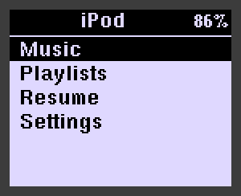 | 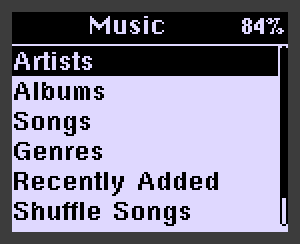 | 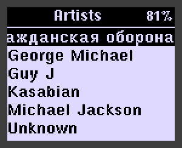 | 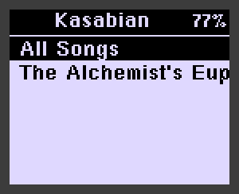 |
| Main menu | Music | Artists | An artist's albums |
| 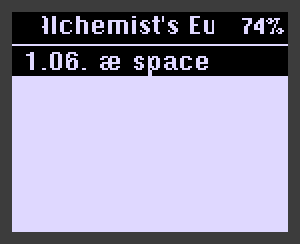 | 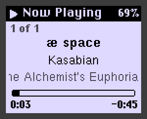 | 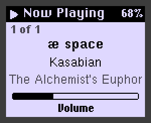 | 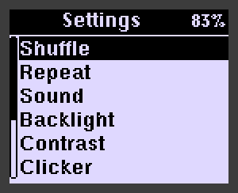 |
| An album's songs | Now Playing | Volume while turning the wheel | Settings |
| 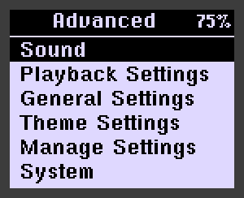 | 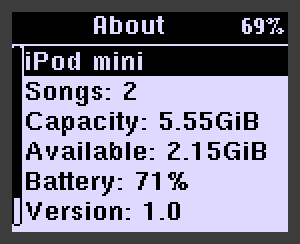 | 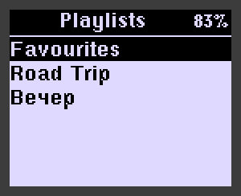 | 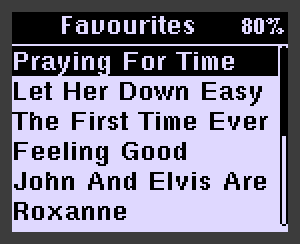 |
| Advanced | About | Playlists | A playlist |
| 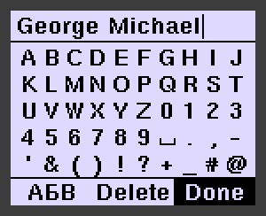 | | | |
| Naming a playlist | | | |

Screenshots are from the Rockbox simulator, enlarged 2x. The real screen is
138x110 pixels in four shades of grey.

## What this is, and is not

podmod is a small patch on top of [Rockbox](https://www.rockbox.org/) plus a
theme, a font, a language file and the scripts used to build and install them.
All of the audio work is Rockbox's.

Hardware limits are unchanged: the mini's DAC is 16-bit / 48 kHz with analogue
output only, so there is no DSD-over-PCM and no external DAC output. Higher
resolution files play, converted down.

It was built and tested on one device: an iPod mini 2G, 6 GB, originally
Mac-formatted. Expect to adapt it for anything else.

## Layout

| Path | What it is |
|---|---|
| `firmware/podmod-firmware.patch` | Changes to Rockbox: Menu button, Settings, About, list entries, playlists, naming screen, startup logo |
| `firmware/build.sh` | Fetches Rockbox at the pinned commit, applies the patch, builds the firmware |
| `firmware/mklogo.py`, `logo-placeholder.txt` | Startup logo generator and a neutral placeholder drawing |
| `tools/build-toolchain.sh` | Builds Rockbox's ARM compiler (GCC 9.5) on Apple Silicon without Homebrew |
| `theme/podmod/.rockbox/` | Files copied to the iPod: theme, now-playing screen, font, Music menu, settings |
| `install-theme.sh` | Copies the theme files to a mounted iPod and verifies them |
| `install-rockbox.sh` | First-time conversion of a Mac-formatted mini to FAT32 with Rockbox (erases the iPod) |
| `fonts/embolden.py` | Makes the bold menu font from a bitmap font while keeping narrow gaps open |
| `lang/mklang.py` | Renames a handful of Rockbox menu strings (for example "Database" to "Music") |
| `simulator/`, `theme/tools/` | Patch and scripts for headless screenshots from the Rockbox simulator |

## Building

On an Apple Silicon Mac with Xcode's command line tools:

```bash
tools/build-toolchain.sh
```

```bash
firmware/build.sh
```

Then, with the iPod (already running Rockbox) mounted as `IPOD`:

```bash
unzip -o firmware/out/rockbox-full.zip -d /Volumes/IPOD
```

```bash
./install-theme.sh
```

Restart the iPod, then pick **iPod Clean** under Settings > Advanced > Theme
Settings > Browse Theme Files.

`install-rockbox.sh` is for the very first install on a Mac-formatted mini. It
checks the disk against the geometry of the device it was written for and
refuses to run on anything else; read it before using it.

## The startup logo

The iPod's ROM shows a logo for a few seconds before Rockbox starts. podmod
draws its own logo at the same position (44x52 pixels at x=47, y=23) so the two
line up. This repository ships a neutral placeholder. Apple's logo is a
trademark and is not included; if you want your device to match its own
power-on screen, trace that screen into `firmware/boot-logo-trace.txt` (same
text format as the placeholder) for your personal use.

## Licensing

- `firmware/podmod-firmware.patch`, `simulator/podmod-simulator.patch` and any
  firmware or language file built from them are derived from Rockbox:
  **GPL-2.0-or-later** (`LICENSES/GPL-2.0-or-later.txt`).
- `fonts/15-Podmod-Helvetica-Bold.*` and the copy under `theme/` are derived
  from the Adobe Helvetica bitmap font and keep its notice
  (`LICENSES/Adobe-Helvetica-BDF.txt`).
- Everything else is **MIT** (`LICENSES/MIT.txt`).

podmod is not affiliated with Apple or with the Rockbox project. iPod is a
trademark of Apple Inc.
